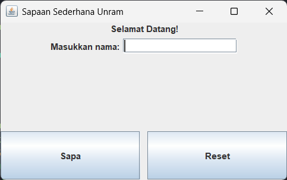
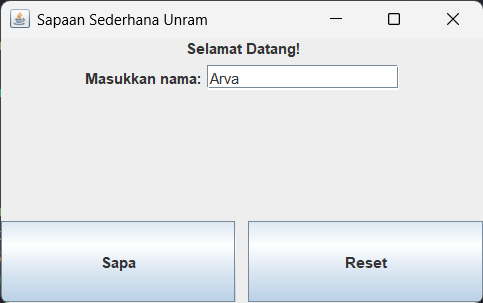
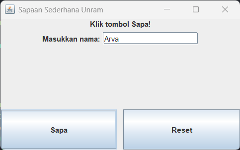
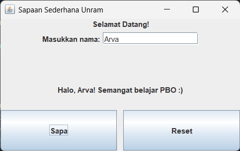

# Latihan GUI Java - Aplikasi Sapaan Sederhana

Program GUI sederhana menggunakan Java Swing. Pengguna mengetik nama, lalu menekan tombol **Sapa** untuk menampilkan pesan sapaan, atau **Reset** untuk mengosongkan isian.

## 5 Komponen Utama GUI yang Digunakan

| No | Komponen | Class / Interface | Penggunaan di Program |
|----|----------|-------------------|-----------------------|
| 1 | Top-level Container Class | `JFrame` | Jendela utama aplikasi (`LatihanGUI extends JFrame`) |
| 2 | Intermediate Container Class | `JPanel` | `panelInput`, `panelTombol`, `panelTengah` untuk mengelompokkan komponen |
| 3 | Atomic Component Class | `JLabel`, `JTextField`, `JButton` | Teks judul/hasil, kolom input nama, tombol Sapa dan Reset |
| 4 | Layout Classes | `BorderLayout`, `FlowLayout`, `GridLayout` | BorderLayout untuk frame, FlowLayout untuk panel input, GridLayout untuk panel tombol dan panel tengah |
| 5 | Event Listener | `ActionListener` (interface), `MouseAdapter` (adapter class) | `actionPerformed()` menangani klik tombol; `mouseEntered()` dan `mouseExited()` mengubah teks judul saat kursor di atas tombol Sapa |

## Screenshot Hasil Program

### 1. Setelah tombol Reset diklik
Pengguna mengisi nama pada `JTextField`.

### 2. Tampilan setelah nama diketik
Event `mouseEntered()` (dari `MouseAdapter`) mengubah teks judul menjadi "Klik tombol Sapa!".

### 3. Kursor berada di atas tombol Sapa
Event `actionPerformed()` (dari `ActionListener`) menampilkan pesan sapaan pada label hasil.

### 4. Setelah tombol Sapa diklik
Isian nama dan pesan hasil dikosongkan kembali.

